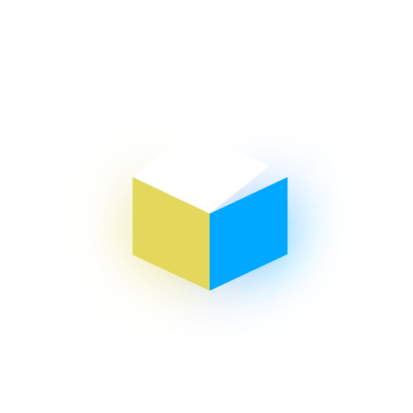
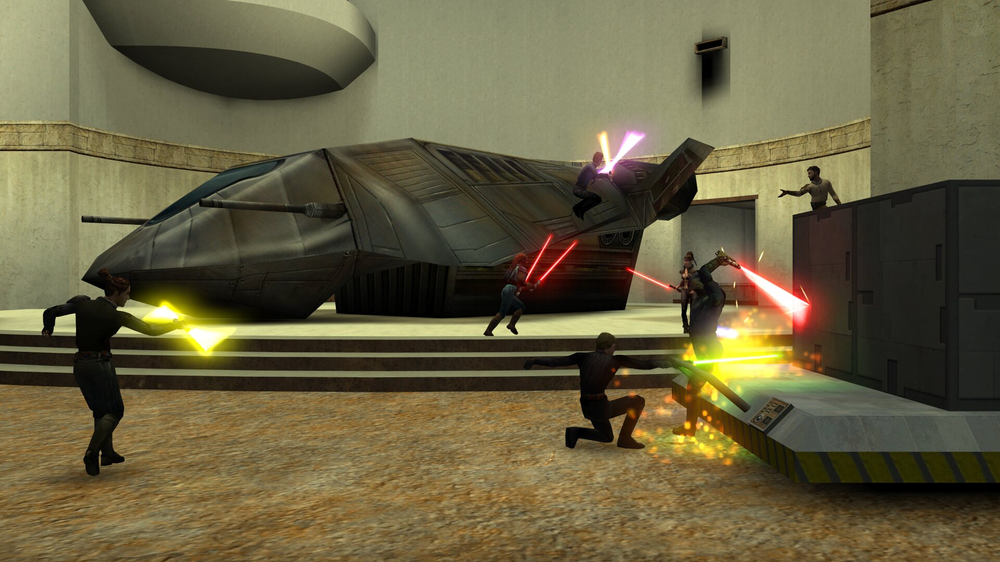

<p align="center">
  <picture>
    <source media="(prefers-color-scheme: light)" srcset="docs/images/logo-light.svg">
    
  </picture>
</p>

<h1 align="center">VisionJK</h1>

<p align="center">
  An engine and game code for Jedi Academy multiplayer, based on OpenJK.<br>
  JA+ is built in, with voice chat, a Vulkan renderer and 3D sound. It joins the servers that are already out there.
</p>

<p align="center">
  <a href="https://jka.vision/download.html"></a>
  
  
  <a href="LICENSE.txt"></a>
</p>

<p align="center">
  <a href="#features">Features</a> ·
  <a href="#download">Download</a> ·
  <a href="#building">Building</a> ·
  <a href="#documentation">Docs</a>
</p>

<p align="center">
  
</p>

VisionJK is the engine and the game code for Jedi Academy multiplayer. It is based on [OpenJK](https://github.com/JACoders/OpenJK) (commit 260c59c2, 2026-09-29) and keeps its compatibility with the existing game, servers and clients. Players with the original game can join your server, and you can join theirs.

The tree is built for 64 bit only. Single player and Jedi Outcast are still in the source but are not built.

> [!IMPORTANT]
> The game, Jedi Academy, has to be installed.

> [!NOTE]
> Not affiliated with Raven Software, Activision, Lucasfilm or Disney.

## Features

- JA+ (v2.4 Build 7) built into the server and the client
- Renderer `rd-vulkan-vision` (Vulkan)
- Voice chat in the client module, relayed by the game module or by the masterserver
- 3D sound with Steam Audio (`v_spatial`)
- Boombox
- Updater
- Web admin panel in the game module
- Chat with history, UTF-8 and CJK text

Players find the features with pictures on [jka.vision](https://jka.vision/features.html) and the [screenshots](https://jka.vision/screenshots.html). More is in the section "VisionJK" at the top of [CHANGELOG.md](CHANGELOG.md). Intrusion detection and the key login for admins are in [docs/japlus/security.md](docs/japlus/security.md).

## Download

Releases and system requirements are on [jka.vision](https://jka.vision/download.html#requirements). The [player guide](https://jka.vision/guide/getting-started.html) and [troubleshooting](https://jka.vision/guide/troubleshooting.html) are there too.

For server operators: the dedicated server `visionjkded.x86_64` is in the Linux release only. The engine starts in the mod folder `japlus` by itself. Settings are written to `~/.local/share/visionjk` on Linux and to `My Games\VisionJK` in the documents folder on Windows, as `visionjk.cfg` (client) and `visionjk_server.cfg` (dedicated server).

## Building

```
cmake -S . -B build64 -DCMAKE_BUILD_TYPE=Release
cmake --build build64 -j"$(nproc)"
cmake --install build64 --prefix release
```

`release/JediAcademy` is then a complete game folder. More, also the Windows cross build with mingw-w64, is in [BUILDING.md](BUILDING.md).

## Privacy

The client sends no identifier made from a key file and asks no update server for a welcome text. More is on [jka.vision](https://jka.vision/privacy.html).

## Documentation

Everything is in [docs/](docs). Building is in [BUILDING.md](BUILDING.md). For the code start with [docs/japlus/README.md](docs/japlus/README.md): it says where the JA+ code is and has the same list as below.

What this tree adds, in [docs/japlus/](docs/japlus):

| File | Content |
|------|---------|
| [README.md](docs/japlus/README.md) | Overview of the JA+ port: what it was rebuilt from, where the code is, the files needed at run time |
| [server.md](docs/japlus/server.md) | The game module: files, state, features, commands, what it tells the client |
| [client.md](docs/japlus/client.md) | cgame and ui: the features of the JA+ client plugin, cvars, prediction |
| [differences.md](docs/japlus/differences.md) | Where the port differs from the original JA+, and which OpenJK behaviour was kept or changed |
| [porting-method.md](docs/japlus/porting-method.md) | How the JA+ binaries were read and how the code was carried over |
| [verification.md](docs/japlus/verification.md) | What was compared against the original modules, what was seen in the game, what is open |
| [webadmin.md](docs/japlus/webadmin.md) | The web admin panel (not a JA+ feature): cvars, requests, how it ties into JA+, limits |
| [voice.md](docs/japlus/voice.md) | Voice chat with the microphone: in the client module, relayed by the game module or by the masterserver, engine unchanged, clients without it unaffected |
| [boombox.md](docs/japlus/boombox.md) | Boxes that play songs of YouTube and the sound system, the quick wheel, the commands and cvars |
| [update.md](docs/japlus/update.md) | The updater of the client: it asks the website for a newer version, fetches what changed and puts it in place |
| [audio.md](docs/japlus/audio.md) | `v_spatial`, sound that knows the level, with Steam Audio: walls muffle, rooms ring, sounds come round corners |
| [renderer.md](docs/japlus/renderer.md) | `rd-vulkan-vision`: how it is built, the state of each part, what is left |
| [ui.md](docs/japlus/ui.md) | The new look of menus and HUD: what a player sees, what a mod's files get, the new words of the menu files |
| [downloads.md](docs/japlus/downloads.md) | Downloads from a server: a window to choose the paks, what is in them before they are used, programs blocked |
| [security.md](docs/japlus/security.md) | Security pass over the network code: findings, fixes, build hardening, server settings |
| [threading.md](docs/japlus/threading.md) | How a frame runs, why server and client share one thread, timing numbers |
| [windows.md](docs/japlus/windows.md) | The Windows client run as a whole on Windows 11: what ran, what it found, what is still unchecked |
| [web.md](docs/japlus/web.md) | The client in a browser, built as WebAssembly and handed out by the dedicated server (switched off for now) |
| [testing.md](docs/japlus/testing.md) | The test scripts of `tools/test/`: smoke test of the zips, sanitizers, unit tests, static checks, the release flow |

Notes on the engine that come from OpenJK, in [docs/](docs):

| File | Content |
|------|---------|
| [libraries.md](docs/libraries.md) | How the engine finds and loads the game, cgame, ui and renderer modules |
| [renderer-architecture.md](docs/renderer-architecture.md) | Front end and back end of the renderer |
| [language strings.md](docs/language%20strings.md) | Format of the string files for the translations |
| [save games.md](docs/save%20games.md) | Layout of a single player save game |
| [sound-code-declutter.md](docs/sound-code-declutter.md) | Notes on the state of the sound code and ideas for tidying it |

## Source code and contributing

The repository on GitHub, [github.com/Blackwolf1337/visionjk](https://github.com/Blackwolf1337/visionjk), is a mirror of the main repository, which is hosted privately. The mirror is updated automatically on every push to the main repository and has all of its branches and tags.

`master` is the line the releases are built from. Branches named `feature/...` and `fix/...` are work in progress and may change or disappear. Every release is a tag `vX.Y.Z` (development builds `vX.Y.Z-dev.N`), so the source of any release can be checked out by its tag.

Issues are welcome on GitHub. Pull requests are welcome too, but they are not merged on GitHub itself, because the mirror would overwrite the merge at the next sync. The change is applied in the main repository with the author kept, it shows up on GitHub with the next sync, and then the pull request is closed.

How to build, the code style and the branch rules are in [CONTRIBUTING.md](CONTRIBUTING.md). Please also read the [Code of Conduct](CODE_OF_CONDUCT.md). Security problems are reported as described in [SECURITY.md](SECURITY.md), not in an issue.

The code of the masterserver that jka.vision runs is not in this repository. [BUILDING.md](BUILDING.md), section "The masterserver", says how it is checked out and built.

## Credits

VisionJK is OpenJK plus the changes of this repository. The engine is the work of the [OpenJK maintainers and contributors](https://github.com/JACoders/OpenJK/graphs/contributors), of the ioquake3 contributors, Raven Software and id Software. The 3D sound comes from Steam Audio by Valve.

## License

VisionJK is free software under the GNU General Public License version 2, see [LICENSE.txt](LICENSE.txt). The copyright notices in the source files name the authors and stay. The icons are the OpenJK icons, see [shared/icons/license.txt](shared/icons/license.txt).
