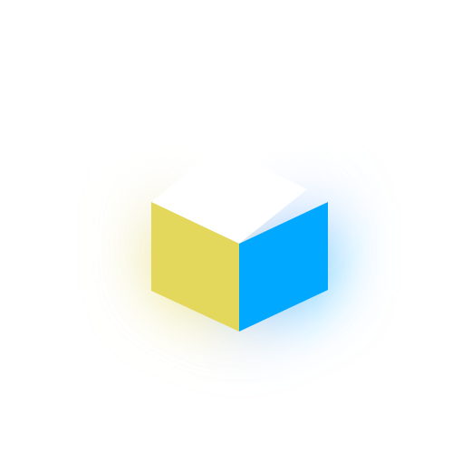
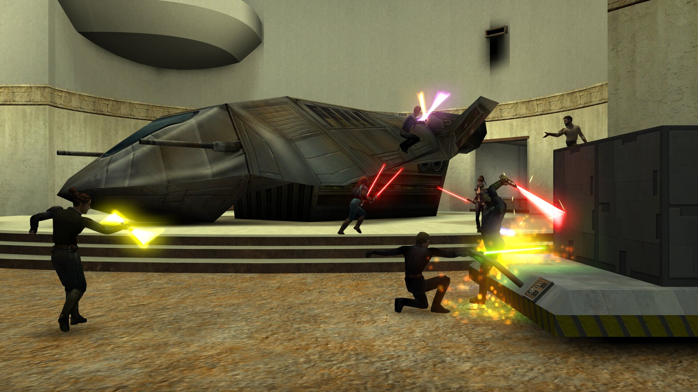
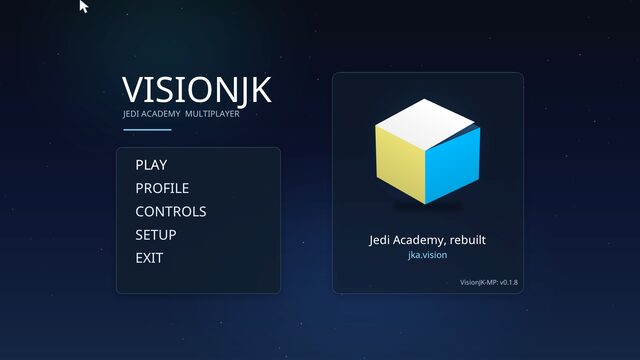
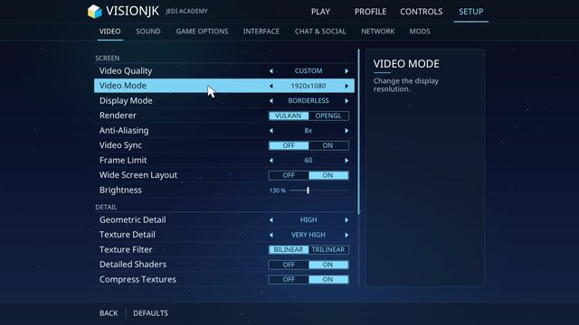
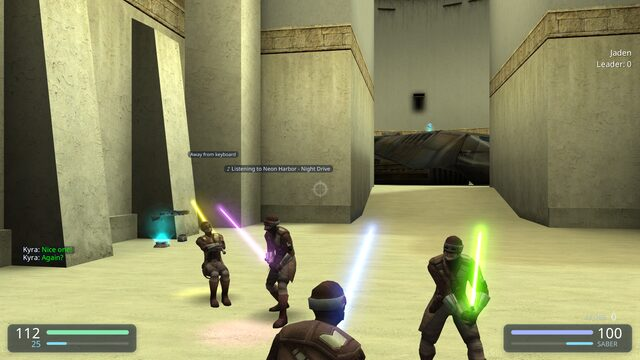
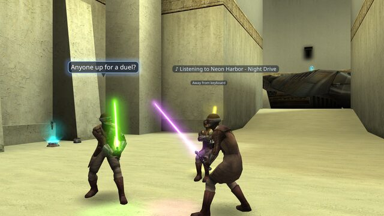
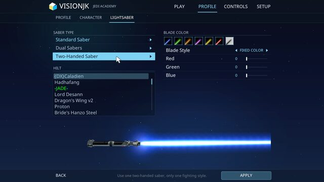
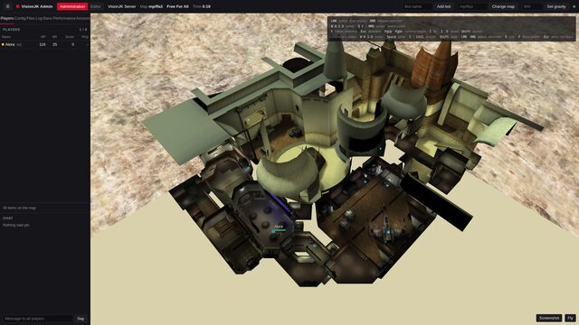

<p align="center">
  
</p>

<h1 align="center">VisionJK</h1>

<p align="center">
  An engine and game code for Jedi Academy multiplayer, based on OpenJK.<br>
  JA+ is built in, with voice chat, a Vulkan renderer and 3D sound. It joins the servers that are already out there.
</p>

<p align="center">
  <a href="https://jka.vision"></a>
  
  <a href="LICENSE.txt"></a>
</p>

<p align="center">
  <a href="#install">Install</a> ·
  <a href="#features">Features</a> ·
  <a href="#getting-started">Getting started</a> ·
  <a href="#controls-and-commands">Controls</a> ·
  <a href="#documentation">Docs</a>
</p>

<p align="center">
  
</p>

VisionJK is the engine and the game code for Jedi Academy multiplayer. It is based on [OpenJK](https://github.com/JACoders/OpenJK) (commit 260c59c2, 2026-09-29) and keeps its compatibility with the existing game, servers and clients. Players with the original game can join your server, and you can join theirs.

The tree is built for 64 bit only. Single player and Jedi Outcast are still in the source but are not built.

The game, Jedi Academy, has to be installed. Not affiliated with Raven Software, Activision, Lucasfilm or Disney.

## Features

<table>
  <tr>
    <td width="50%" valign="top">
      <h3> JA+</h3>
      The features of the JA+ mod v2.4 Build 7, on the server and in the client. Duels, emotes, the grappling hook, the jetpack and sabers in any color. No extra mod to install.
    </td>
    <td width="50%" valign="top">
      <h3> Renderer</h3>
      A Vulkan renderer, <code>rd-vulkan-vision</code>, next to <code>rd-vanilla</code>. The classic renderer takes over when the new one can not run. On a wide window the menus and the HUD keep their shape.
    </td>
  </tr>
  <tr>
    <td valign="top">
      <h3> Voice chat</h3>
      Push to talk or voice activation. Each voice comes from where its player stands. A clan radio reaches the clan anywhere on the map. Servers without the game module use the masterserver.
    </td>
    <td valign="top">
      <h3> 3D sound</h3>
      Sound with Steam Audio (<code>v_spatial</code>). Walls muffle, rooms ring and sounds come round corners. Sound is heard from the head of the player, not from the camera.
    </td>
  </tr>
  <tr>
    <td valign="top">
      <h3> Boombox</h3>
      Boxes in the level that play songs of YouTube and YouTube Music for everybody near them. A sound system with two speakers plays one song in stereo. A quick wheel places them. Only VisionJK players see and hear them.
    </td>
    <td valign="top">
      <h3> Updater</h3>
      The client updates itself from the website when the player says so. It also repairs a game file that is missing or from another version.
    </td>
  </tr>
  <tr>
    <td valign="top">
      <h3> Web admin panel</h3>
      A panel in the game module: a live map with all players, accounts with three roles and a second login step, and an editor for the objects in a level. Admins can log in with an Ed25519 key.
    </td>
    <td valign="top">
      <h3> Chat</h3>
      A chat box with 256 lines of history, text that can be marked and copied, and links. Speech bubbles over the heads. Text is UTF-8, and Chinese, Japanese and Korean are drawn.
    </td>
  </tr>
</table>

More is in the section "VisionJK" at the top of [CHANGELOG.md](CHANGELOG.md): new menus and HUD with the old ones one cvar away (`v_classic 1`, `v_hud 0`), clickable players and scoreboard rows, notifications, a blade style and duel effects, and a review window for downloads from a server. Intrusion detection and the key login for admins are in [docs/japlus/security.md](docs/japlus/security.md).

<table>
  <tr>
    <td width="50%"></td>
    <td width="50%"></td>
  </tr>
  <tr>
    <td align="center"><sub>Main menu</sub></td>
    <td align="center"><sub>Setup, Video: the renderer is a switch between Vulkan and OpenGL</sub></td>
  </tr>
  <tr>
    <td width="50%"></td>
    <td width="50%"></td>
  </tr>
  <tr>
    <td align="center"><sub>The new HUD, with a status over a player's head</sub></td>
    <td align="center"><sub>A speech bubble and the music a player listens to</sub></td>
  </tr>
  <tr>
    <td width="50%"></td>
    <td width="50%"></td>
  </tr>
  <tr>
    <td align="center"><sub>Profile, Lightsaber: hilt and blade color</sub></td>
    <td align="center"><sub>The web admin panel</sub></td>
  </tr>
</table>

## Install

Releases are on [jka.vision](https://jka.vision). The version now is 0.2.7.

| System | Needs | |
|---|---|---|
| Windows | Windows 10 or newer, 64 bit | Run `visionjk.x86_64.exe`. The dedicated server is in the Linux release only. |
| Linux | 64 bit, glibc 2.34 or newer, SDL2 | Run `visionjk.x86_64`. The dedicated server is `visionjkded.x86_64`. |

Jedi Academy has to be installed. Put the content of the release folder into its `GameData` folder and run the program from there.

The engine starts in the mod folder `japlus` by itself. Settings are written to `~/.local/share/visionjk` on Linux and to `My Games\VisionJK` in the documents folder on Windows, as `visionjk.cfg` (client) and `visionjk_server.cfg` (dedicated server).

### Building

```
cmake -S . -B build64 -DCMAKE_BUILD_TYPE=Release
cmake --build build64 -j"$(nproc)"
cmake --install build64 --prefix release
```

`release/JediAcademy` is then a complete game folder. More, also the Windows cross build with mingw-w64, is in [docs/japlus/README.md](docs/japlus/README.md).

## Getting started

Start `visionjk.x86_64` (Linux) or `visionjk.x86_64.exe` (Windows) in `GameData`. The main menu comes up with JA+ already active.

Choose Play, then Join a Game, pick a server and join. VisionJK works with normal Jedi Academy servers, also ones that run other mods. On a server that runs VisionJK you get everything, voice chat and the extras included. On other servers you play by their rules.

Open Controls, then Extras, and give keys to the grappling hook, the jetpack, the full force duel and the voice chat. The server decides what is allowed. If the hook or the jetpack do nothing, the server has switched them off.

Setup has the video, sound, interface, chat and network options. Setup, Video has the renderer: Vulkan is the new one, OpenGL the classic one. Setup, Sound has 3D sound and the voice chat settings.

The client tells you when a new version is out: a line appears at the bottom of the main menu, and a click updates the game. To do this it asks the website once at every start. `v_updateCheck 0` switches that off.

Hold the left Alt key and the mouse is free. Point at a player and he gets a glowing outline. A click opens a card with his voice, his chat lines, a whisper and a vote. Press the scoreboard key twice quickly to keep the board open and click a row.

## Controls and commands

Keys are set under Controls, Extras. Commands go into the console.

| Key or command | Action |
|---|---|
| Grapple Hook | hold to shoot the hook, use key to drop off |
| JetPack | pick up a jetpack, then jump and press use in the air |
| Voice Chat (Talk) | hold to talk |
| Clan Radio (Talk), `+v_voiceclan` | talk to the clan with the same clan password |
| Free the Mouse (Select Players), `+v_cursor` | free the mouse to click players, left Alt by default |
| Quick Wheel (Boombox), `+v_radial` | a ring to place a boombox or a sound system, not bound by default |
| Scoreboard key twice | keep the scoreboard open with the mouse free |
| `v_voice_mute <name>` | mute a player, `v_voice_unmute <name>` or `all` undoes it |
| `v_voice_status` | show if the voice chat is connected |
| `boombox play <link or words>` | play a song in a box near you or in a new one |
| `boombox place`, `boombox system` | put down a boombox or a sound system where the crosshair points |
| `amsit`, `amhello`, `amkneel`, `amvictory` | emotes, all 27 are in [docs/japlus/server.md](docs/japlus/server.md) |
| `amflip`, `amaltdim`, `toggleflame` | a flip, the alternate dimension, a flamethrower for force lightning |
| `v_saberStyle 1` | thin white core with a glow for lightsaber blades |

## Troubleshooting

<details>
<summary>The game does not start or says files are missing</summary>

Check that the VisionJK files are directly inside `GameData`, next to the folder `base`, and not one folder deeper.
</details>

<details>
<summary>The picture looks wrong</summary>

VisionJK switches to the classic renderer by itself when the new one can not run. You can choose it under Setup, Video, Renderer.
</details>

<details>
<summary>Nobody hears you in the voice chat</summary>

Set a key for Voice Chat (Talk) under Controls, Extras. Use headphones, or the others hear themselves through your microphone. `v_voice_status` shows if the chat is connected.
</details>

<details>
<summary>The hook or the jetpack do nothing</summary>

The server has switched them off.
</details>

<details>
<summary>The left Alt key does not free the mouse</summary>

If the left Alt key already does something else for you, choose another key for Free the Mouse (Select Players) under Controls, Extras.
</details>

<details>
<summary>Version 0.1.1 on Windows says the update failed</summary>

That version can not update itself. Download the current version once and copy it over the game folder.
</details>

## Privacy

The client has no `ja_guid`. OpenJK makes a key file (`jakey`) and sends an identifier made from it to every server it joins. VisionJK does neither. A server sees it like the original game, without a GUID.

`cl_motd` is 0 by default. Switched on, the client asks the update server for a news line on every connect and sends the name and vendor of the graphics card, version, platform, joystick setting and color depth along.

## Documentation

Everything is in [docs/](docs). Start with [docs/japlus/README.md](docs/japlus/README.md): it says where the JA+ code is, how the tree is built and released, and has the same list as below.

What this tree adds, in [docs/japlus/](docs/japlus):

| File | Content |
|------|---------|
| [README.md](docs/japlus/README.md) | Overview of the JA+ port: what it was rebuilt from, where the code is, building, the release folder |
| [server.md](docs/japlus/server.md) | The game module: files, state, features, commands, what it tells the client |
| [client.md](docs/japlus/client.md) | cgame and ui: the features of the JA+ client plugin, cvars, prediction |
| [differences.md](docs/japlus/differences.md) | Where the port differs from the original JA+, and which OpenJK behaviour was kept or changed |
| [porting-method.md](docs/japlus/porting-method.md) | How the JA+ binaries were read and how the code was carried over |
| [verification.md](docs/japlus/verification.md) | What was compared against the original modules, what was seen in the game, what is open |
| [webadmin.md](docs/japlus/webadmin.md) | The web admin panel (not a JA+ feature): cvars, requests, how it ties into JA+, limits |
| [voice.md](docs/japlus/voice.md) | Voice chat with the microphone: in the client module, relayed by the game module or by the masterserver, engine unchanged, clients without it unaffected |
| [boombox.md](docs/japlus/boombox.md) | Boxes that play songs of YouTube and the sound system, the quick wheel, the commands and cvars |
| [update.md](docs/japlus/update.md) | The updater of the client: it asks the website for a newer version, fetches what changed and puts it in place |
| [audio.md](docs/japlus/audio.md) | `v_spatial`, sound that knows the level, with Steam Audio: walls muffle, rooms ring, sounds come round corners |
| [renderer.md](docs/japlus/renderer.md) | `rd-vulkan-vision`: how it is built, the state of each part, differences to `rd-vanilla`, what is left |
| [ui.md](docs/japlus/ui.md) | The new look of menus and HUD: what a player sees, what a mod's files get, the new words of the menu files |
| [downloads.md](docs/japlus/downloads.md) | Downloads from a server: a window to choose the paks, what is in them before they are used, programs blocked |
| [security.md](docs/japlus/security.md) | Security pass over the network code: findings, fixes, build hardening, server settings |
| [threading.md](docs/japlus/threading.md) | How a frame runs, why server and client share one thread, timing numbers |
| [windows.md](docs/japlus/windows.md) | The Windows client run as a whole on Windows 11: what ran, what it found, what is still unchecked |
| [web.md](docs/japlus/web.md) | The client in a browser, built as WebAssembly and handed out by the dedicated server |
| [testing.md](docs/japlus/testing.md) | The test scripts of `tools/test/`: smoke test of the zips, sanitizers, unit tests, static checks, the release flow |

Notes on the engine that come from OpenJK, in [docs/](docs):

| File | Content |
|------|---------|
| [libraries.md](docs/libraries.md) | How the engine finds and loads the game, cgame, ui and renderer modules |
| [renderer-architecture.md](docs/renderer-architecture.md) | Front end and back end of the renderer |
| [language strings.md](docs/language%20strings.md) | Format of the string files for the translations |
| [save games.md](docs/save%20games.md) | Layout of a single player save game |
| [sound-code-declutter.md](docs/sound-code-declutter.md) | Notes on the state of the sound code and ideas for tidying it |

## Credits

VisionJK is OpenJK plus the changes of this repository. The engine is the work of the [OpenJK maintainers and contributors](https://github.com/JACoders/OpenJK/graphs/contributors), of the ioquake3 contributors, Raven Software and id Software. The 3D sound comes from Steam Audio by Valve. The source is hosted at [github.com/Blackwolf1337/visionjk](https://github.com/Blackwolf1337/visionjk).

## License

VisionJK is free software under the GNU General Public License version 2, see [LICENSE.txt](LICENSE.txt). The copyright notices in the source files name the authors and stay. The icons are the OpenJK icons, see [shared/icons/license.txt](shared/icons/license.txt).
